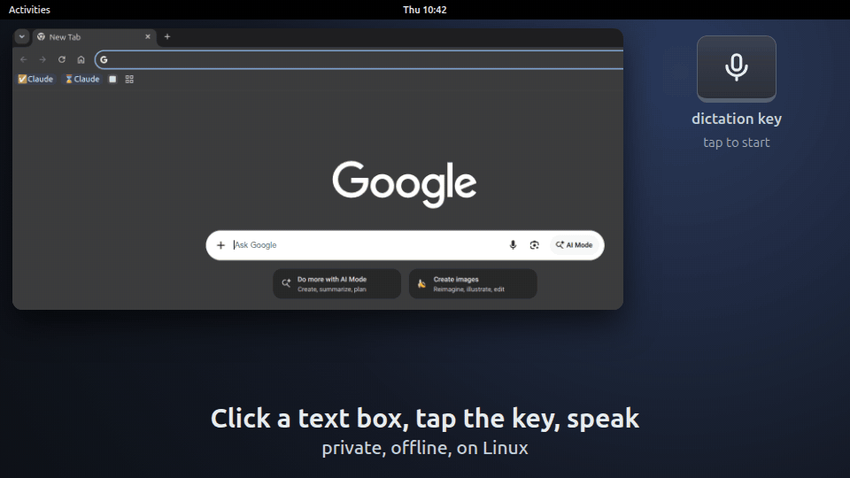

# 🐧 TuxWhisper

**Private, offline dictation for Linux.** Press a key, speak, and your words are typed
wherever your cursor is: a browser text box, an LLM chat prompt, your editor or your
terminal. Everything runs on your own machine with free, open models. Your voice never
reaches a cloud service, and there's nothing to pay for.

[](https://github.com/ialmajai/tuxwhisper/actions/workflows/ci.yml)
[](LICENSE)




## Features

- **Fast:** OpenAI's open Whisper model ([faster-whisper](https://github.com/SYSTRAN/faster-whisper))
  types your words about half a second after you release the key, with an NVIDIA GPU.
- **Types anywhere:** browsers, editors, terminals, on X11 and Wayland (including GNOME).
- **LLM cleanup (optional):** F3 runs your words through a local [Ollama](https://ollama.com)
  model (Meta's Llama 3.2 by default) that removes "um"s and fixes punctuation, or rewrites
  them as an email, bullet points or your own mode.
- **Many languages:** dictate in any of Whisper's 100 languages. F3 replies in the language
  you spoke; Llama 3.2 is weak outside English, so [pick a stronger model](docs/llm-cleanup.md)
  for other languages.

**Also:** tap or hold to talk, a custom vocabulary for names and jargon, replacements such as
"new line" → line break, a settings menu with your last 20 transcripts, and
[saved recordings](docs/saving-takes.md) for fine-tuning Whisper to your voice and accent.
TuxWhisper types by pasting, then puts back whatever you had copied.

Tested on GNOME (Wayland) with an NVIDIA GPU and in CPU mode, and on
[Sway and i3](docs/other-desktops.md).

## Usage

| Key | Action |
|-----|--------|
| **F5** | Tap to start, tap to stop, or hold to talk. The text is typed at your cursor. |
| **F3** | Same as F5, with [LLM cleanup](docs/llm-cleanup.md). |
| **F4** | [Save the last recording](docs/saving-takes.md) and its transcript for fine-tuning. |
| **Alt+F9** | Open the [settings menu](docs/configuration.md#settings-menu). |

You bind these keys in step 4 below. Wait for the "🎙 Recording…" notification and the start
sound before speaking.

## Quick start

**Requirements:**

- Linux with systemd, and [uv](https://docs.astral.sh/uv/) (it installs Python 3.12 for you)
- An NVIDIA GPU with about 1.5 GB of free VRAM, or [CPU mode](docs/configuration.md#cpu-mode)
- `xclip`, which also works on Wayland desktops that run XWayland (GNOME and KDE do). Without
  XWayland, use `wl-clipboard`.
- `zenity`, for the settings menu

### 1. Clone and install

```bash
git clone https://github.com/ialmajai/tuxwhisper.git ~/tuxwhisper
cd ~/tuxwhisper
uv venv --python 3.12 .venv
uv pip install --python .venv -r requirements-cuda.txt
```

No NVIDIA GPU? Install `requirements.txt` instead of `requirements-cuda.txt`.

### 2. Allow the virtual keyboard

TuxWhisper pastes by pressing keys on a virtual keyboard, which needs this rule (and sudo,
once). The rule lets **any program you run** send keystrokes, not only TuxWhisper; read the
[security note](docs/security.md). Skip it and TuxWhisper copies each transcript for you to
paste with Ctrl+V instead. To undo it, delete the file and reboot.

```bash
echo 'KERNEL=="uinput", TAG+="uaccess", OPTIONS+="static_node=uinput"' |
  sudo tee /etc/udev/rules.d/60-uinput.rules
sudo udevadm control --reload && sudo udevadm trigger --name-match=uinput
```

### 3. Start the daemon at login

```bash
mkdir -p ~/.config/systemd/user
cp tuxwhisper.service ~/.config/systemd/user/
```

No NVIDIA GPU? Switch the service to CPU mode before starting it:

```bash
mkdir -p ~/.config/systemd/user/tuxwhisper.service.d
printf '[Service]\nEnvironment=ASR_DEVICE=cpu\n' > ~/.config/systemd/user/tuxwhisper.service.d/cpu.conf
```

Start it and watch it load:

```bash
systemctl --user enable --now tuxwhisper
journalctl --user -u tuxwhisper -f    # wait for "ready", then press Ctrl+C
```

The first start downloads the Whisper model to `~/.cache/huggingface` (about 1.5 GB; the CPU
model is smaller), so it takes a while. After that, startup takes about 15 s.

The service expects the repo at `~/tuxwhisper`. If it's elsewhere, edit `ExecStart` in the
copied file and use your path in step 4.

### 4. Bind the keys

On GNOME: Settings → Keyboard → Keyboard Shortcuts → Custom Shortcuts. Replace `<you>` with
your username; shortcut commands don't expand `~`.

| Shortcut | Command |
|---|---|
| F5 | `/home/<you>/tuxwhisper/asr toggle` |
| F3 | `/home/<you>/tuxwhisper/asr rewrite` |
| F4 | `/home/<you>/tuxwhisper/asr save` |
| Alt+F9 | `/home/<you>/tuxwhisper/asr settings` |

> [!TIP]
> Binding F5 overrides page refresh in browsers. Ctrl+R still refreshes.

KDE, Hyprland, Sway, i3: see [Other desktops](docs/other-desktops.md). To also open the
settings menu from your app grid ("TuxWhisper Settings"), run this in the repo folder:

```bash
sed "s|@DIR@|$PWD|" tuxwhisper-settings.desktop \
  > ~/.local/share/applications/tuxwhisper-settings.desktop
```

### 5. Try it

Click into any text box, hold F5, wait for the start sound, speak, and release. Your words
appear at the cursor. Nothing typed? See [Troubleshooting](docs/troubleshooting.md).

### 6. Optional: LLM cleanup (F3)

Install [Ollama](https://docs.ollama.com/linux) and the cleanup model. The official install
script:

```bash
curl -fsSL https://ollama.com/install.sh | sh
ollama pull llama3.2
```

## Uninstall

```bash
systemctl --user disable --now tuxwhisper
rm -rf ~/.config/systemd/user/tuxwhisper.service ~/.config/systemd/user/tuxwhisper.service.d
rm -f ~/.local/share/applications/tuxwhisper-settings.desktop
sudo rm /etc/udev/rules.d/60-uinput.rules
```

Then remove the keyboard shortcuts and delete the repo folder. The folder also holds any
recordings you saved with F4, in `recordings/`. The Whisper model stays in
`~/.cache/huggingface/hub` until you delete it, and settings stay in `~/.config/tuxwhisper`.

## Documentation

- [LLM cleanup (F3)](docs/llm-cleanup.md)
- [Saving recordings for fine-tuning (F4)](docs/saving-takes.md)
- [Configuration](docs/configuration.md): settings menu, custom vocabulary, replacements, CPU mode
- [Other desktops](docs/other-desktops.md)
- [How it works](docs/how-it-works.md)
- [Security](docs/security.md)
- [Troubleshooting](docs/troubleshooting.md)

## License

[MIT](LICENSE) © 2026 Ibrahim Almajai
